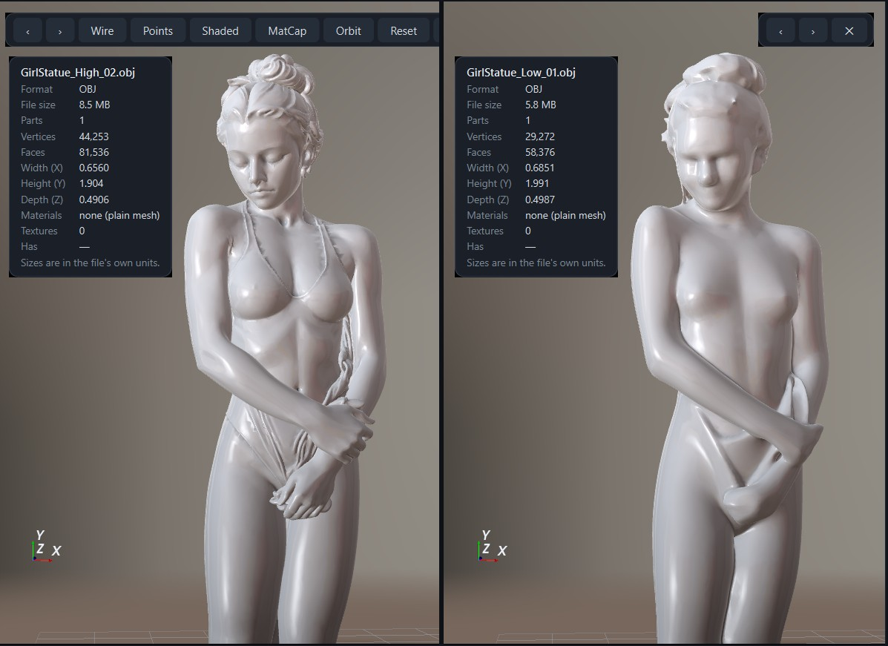
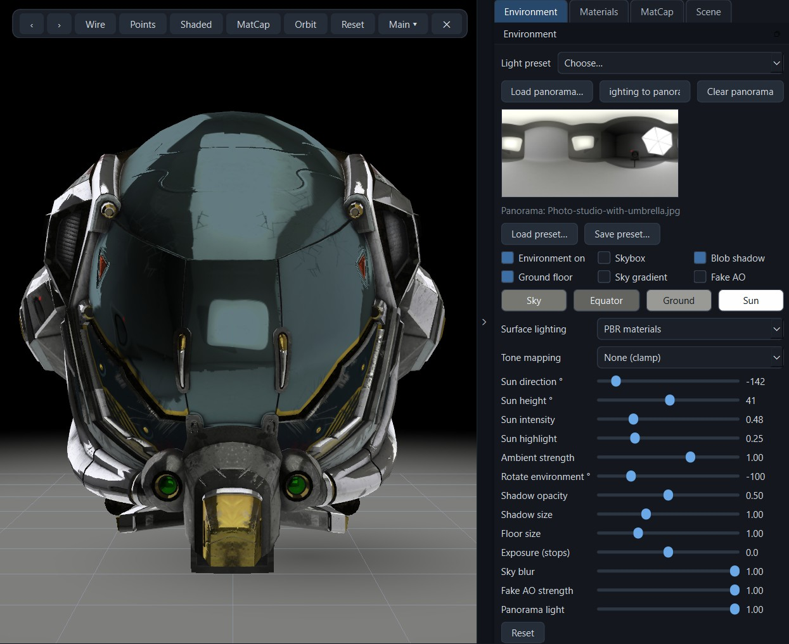
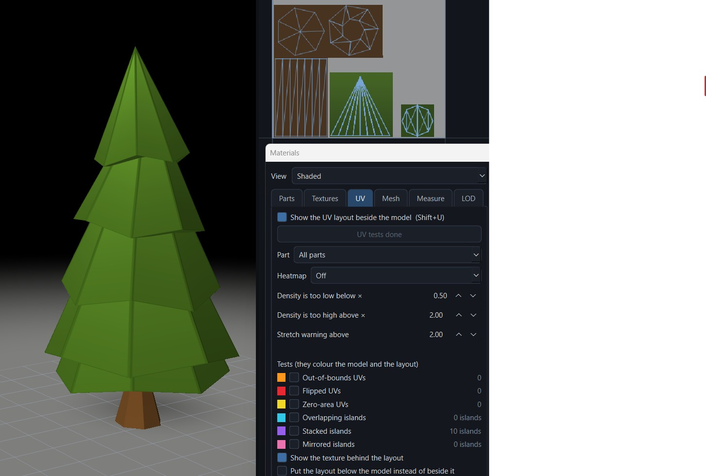

# Gleek3Deek

**A fast, minimalist 3D asset manager, viewer and auditor.** Browse a folder of models as a thumbnail gallery, open any of them in an interactive 3D viewer, and find out what's wrong with it, all in a small native app. No Electron, no web view: just Python, Qt and VTK.

> **Status:** early release. Expect rough edges, and please report them in the Issues tab.

## Why Gleek3Deek?

You have a folder full of models from a dozen sources and you want to *see* them, sort them and trust them, without opening a heavyweight 3D package for each one. Gleek3Deek gives you a visual library, a viewer that opens instantly, and checks that tell you whether a model is ready to use.

## Highlights

### Browse and organise
- **Folder tree + thumbnail gallery** with real rendered thumbnails, cached on disk so revisiting a folder is instant.
- **Star ratings, colour labels and tags**, plus **smart folders** (saved searches such as `tag:prop rating:>=4`). Stored in one small JSON file next to the app, never inside your model files.
- **Favourite and recent folders**, search, sort, card-size slider, and rename / copy / move / delete from the gallery.

### View
- **Opens instantly** on double-click, with the camera fitted to the model. Previous/next browsing with the arrow keys.
- **Material views:** albedo, normals, texture inspector with channel previews, and a parts list to hide or isolate pieces.
- **MatCap shading** with five ZBrush-style procedural materials, a live MatCap editor and **split compare** against normal shading
- **Environment lighting:** panorama sky, sun, soft shadow, **panorama irradiance** (diffuse light from the sky image), **PBR materials** (metallic/roughness look; glossy surfaces reflect the loaded panorama) and **Fake AO**, tuned to stay fast on low-end machines.

- **Scene tools:** ground grid, field of view, saved camera views, orthographic mode, auto-orbit, screenshots up to 4× with a transparent background.

### Inspect
- **UV inspection** with a layout view that flags overlaps, flipped and out-of-bounds UVs.

- **Texture audit and mesh diagnostics:** oversized or non-power-of-two textures, holes, non-manifold edges, flipped faces and more.
- **Measurements and cross-section** for checking real-world scale.
- **LOD preview** to see how a model looks at a fraction of its faces.

### Convert and automate
- **Export** to STL, OBJ or PLY, optionally simplified to a percentage of the faces.
- **Reference sheets** for AI 3D tools: several views of a model on one image, ready for Meshy, Tripo, Rodin and similar tools.
- **Command-line mode** that audits whole folders and writes reports, read-only by design.

### Works with what you have
glTF/GLB (including Draco and Meshopt compressed), OBJ, STL, PLY, FBX, DAE, USD, 3MF, STEP, `.blend` (with Blender installed) and dozens more through Assimp. See [Supported formats](GUIDE.md#supported-formats).

## Download (Windows, no Python needed)

Go to the **[Releases](https://github.com/astroskiffle/Gleek3Deek/releases)** page, download `Gleek3Deek.exe` and double-click it. Nothing to install.

- The first launch takes a few seconds longer, because the single-file exe unpacks itself to a temporary folder each time it starts.
- The exe is not code-signed, so Windows SmartScreen may say "Windows protected your PC". Choose **More info → Run anyway**. Some antivirus tools also flag PyInstaller programs by mistake; you can always run from source instead.

## Run from source

You need **Python 3.10 – 3.12**.

**Windows:** double-click `run.bat`  
**macOS / Linux:** `./run.sh` (on a Wayland desktop the script switches Qt to X11 for you; to force a platform yourself, set `QT_QPA_PLATFORM`)

On first launch the script creates a private `.venv`, installs the dependencies and starts the app. You can also pass a folder or a model file, for example `./run.sh path/to/models`. Manual install steps are in the [guide](GUIDE.md#quick-start-from-source).

## Essential shortcuts

| Key | Action |
|---|---|
| Double-click | Open a model in the viewer |
| `M` | Cycle MatCap materials |
| `D` | Split compare (MatCap vs normal shading) |
| `K` | Compare two models side by side |
| `Shift+W` | Edges over shaded |
| `Ctrl+1`…`5` / `Ctrl+0` | Rate the selected files / clear the rating |
| `Ctrl+T` | Edit tags |
| Arrow keys | Previous / next model in the viewer |
| `Ctrl+B` | Hide / show the side panels |

The complete list is under [Controls](GUIDE.md#controls).

## Documentation

The **[user guide](GUIDE.md)** covers everything in detail: the library, every panel and tool, the command-line mode, supported formats, building the exe and troubleshooting.

## Contributing

Issues and pull requests are welcome. When reporting a model that won't open, please include the file format, the exact text of the error box, and (if you can share it) a small sample file. To run the tests: `pip install pytest` then `pytest` (see the [guide](GUIDE.md#running-the-tests)).

## License

Gleek3Deek is released under the MIT License (see `LICENSE`). It depends on [PySide6](https://doc.qt.io/qtforpython/) (LGPL), [VTK](https://vtk.org/) (BSD), [NumPy](https://numpy.org/) (BSD) and, optionally, [assimp-py](https://pypi.org/project/assimp-py/) / [Assimp](https://github.com/assimp/assimp) (BSD), [DracoPy](https://pypi.org/project/DracoPy/) / [Draco](https://github.com/google/draco) (Apache-2.0), [meshoptimizer](https://pypi.org/project/meshoptimizer/) / [meshoptimizer](https://github.com/zeux/meshoptimizer) (MIT) and [CadQuery](https://github.com/CadQuery/cadquery) (Apache-2.0), each under its own license.
