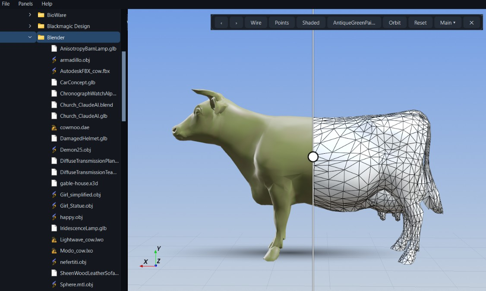
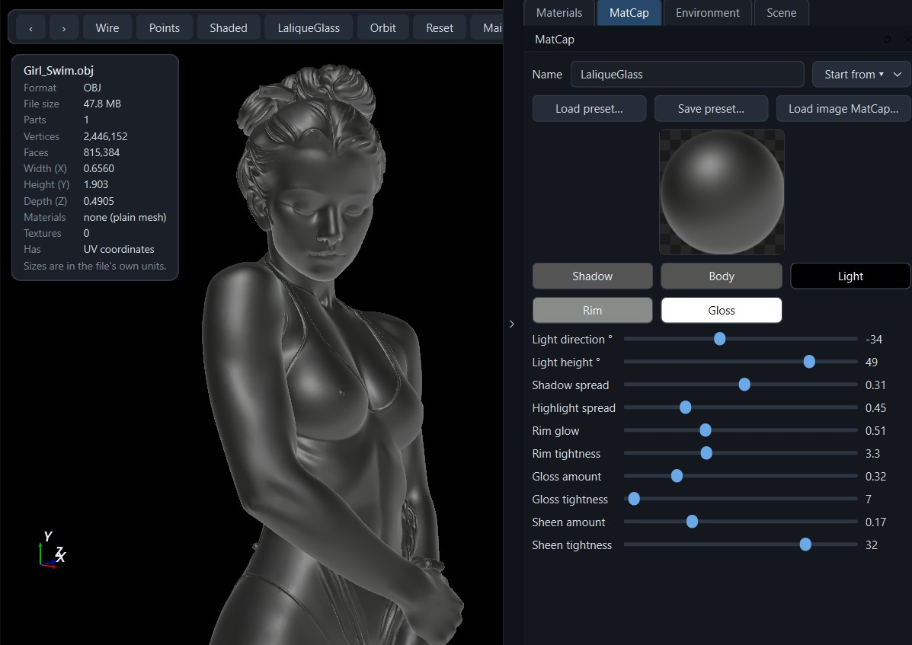
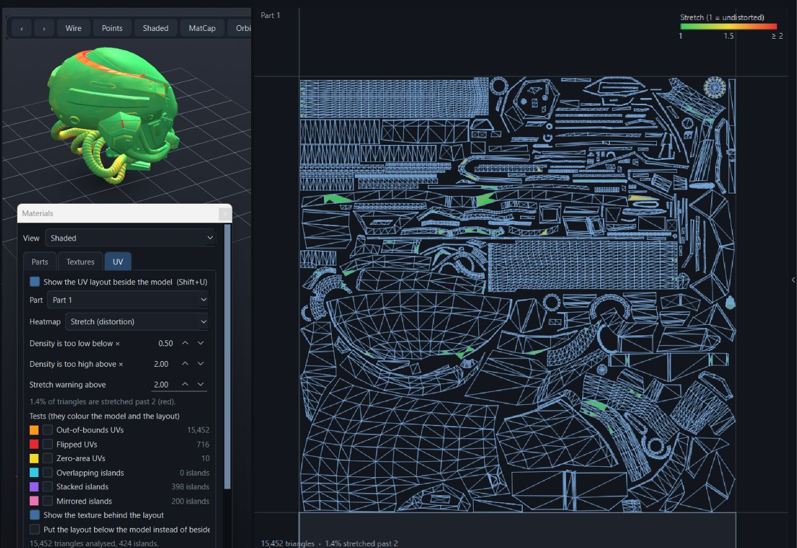

# Gleek3Deek

A fast, minimalist, native 3D asset browser and viewer. Browse a folder of models as a thumbnail gallery, double-click to open any of them in an interactive 3D viewer. No Electron, no web view, just Python, Qt and VTK.

> **Status:** early release. Expect rough edges, and please report them in the Issues tab.



## Features

- **Folder tree + visual gallery:** nested folder navigation on the left, a grid of cards on the right. Only 3D formats are shown. The last opened folder is remembered.
- **Real thumbnails:** rendered in the background and cached on disk, so revisiting a folder is instant.
- **MatCap editor:** tweak a material's colours, light and gloss live, save/load presets as small JSON files, or load a sphere image (including ZBrush MatCap exports).
- **Export / convert:** save the model as STL, OBJ or PLY, optionally simplified to a percentage of its faces.
- **Model info:** a card with the model's vertex and face counts, dimensions, materials, textures and file size.
- **Menus:** a File menu (open folder, export, quit) and a Help menu (About), alongside the keyboard shortcuts.
- **Side panels:** Materials, MatCap, Environment and Scene panels in a right-hand drawer that you can tab, stack and collapse, with the layout remembered between sessions.
- **Material views:** an albedo view (colours and textures with no lighting), a normals view, a texture inspector with channel previews, and a parts list to hide or isolate pieces of a model.
- **Scene tools:** ground grid, field of view, saved camera views, edges over shaded, move to ground or origin, and screenshots with 1×/2×/4× size and a transparent background.
- **Environment:** an infinite panorama sky, cheap hemispheric ambient light, one sun and a soft blob shadow, all fitted automatically from a panorama image. Built to stay fast on low-end machines.
- **Gallery tools:** search, sort, a card-size slider, and a right-click menu to rename, copy, paste and delete files.
- **Viewer tools:** auto-orbit, backgrounds, axes gizmo, standard views, orthographic mode, Z-up fix, screenshots, and previous/next browsing with the arrow keys.
- **Instant viewer:** double-click a card (or a file in the tree). Auto-fits the camera to the model.
- **MatCap shading:** press `M` to cycle five ZBrush-style MatCap materials (Red Wax, Clay Matte Green, RealSkin, Framer, RoughMetal). They are original procedural shaders, not copies of ZBrush's images.
- **Textures and colours:** glTF/GLB, OBJ+MTL and FBX/DAE/LWO materials, vertex colours and face colours.
- **Never freezes:** all file parsing runs on background threads.
- **Friendly errors:** a file that fails to load shows an error box inside the viewer instead of crashing the app.

## Download (Windows, no Python needed)

Go to the **[Releases](../../releases)** page, download `Gleek3Deek.exe` and double-click it. Nothing to install.

- The first launch takes a few seconds longer, because the single-file exe unpacks itself to a temporary folder each time it starts.
- The exe is not code-signed, so Windows SmartScreen may say "Windows protected your PC". Choose **More info → Run anyway**. Some antivirus tools also flag PyInstaller programs by mistake; you can always run from source instead (below).

## Quick start (from source)

You need **Python 3.10 – 3.12** (3.9 and 3.13 may work depending on the VTK wheel available for your platform).

**Windows:** double-click `run.bat`

**macOS / Linux:**
```bash
./run.sh
```

On first launch the script creates a private `.venv` folder, installs the dependencies, then starts the app. Later launches start immediately.

You can also pass a folder or a model file:
```bash
./run.sh path/to/models
run.bat C:\Models\chair.glb
```

### Manual install

```bash
pip install -r requirements.txt
pip install assimp-py      # optional: FBX / DAE / LWO / 3DS
python main.py
```

## Controls

**Gallery**

| Action | Input |
|---|---|
| Open an asset | Double-click a card or a file in the tree |
| Go to a folder | Type or paste a path in the address bar at the left of the toolbar and press Enter (`Alt+D` jumps there). A file path opens that file. The bar turns red if the path does not exist. The **↑** button goes to the parent folder (`Alt+Up`) |
| Search | Type in the search box (matches name and extension) |
| Sort | Drop-down: name, date, size or type |
| Card size | Slider at the right of the toolbar (remembered) |

**Viewer**

| Action | Input |
|---|---|
| Orbit / Zoom / Pan | Left / Right / Middle mouse drag (scroll also zooms). Orbit is a turntable by default; press `H` for free rotation |
| Previous / next model in the folder | `←` / `→` (or the ‹ › buttons) |
| Auto-orbit turntable | `O` (pauses while you drag; speed is in the **View** menu) |
| Cycle background | `B` (more options, including a custom colour, in the **View** menu) |
| Axes gizmo on/off | `A` |
| Perspective / orthographic | `C` |
| Standard views | `1` Front, `2` Back, `3` Right, `4` Left, `5` Top, `6` Bottom, `7` Isometric |
| Z-up model fix | `U` (remembered per file; also fixes its thumbnail) |
| Transparency on/off | `T` (models load solid; this restores a material's own transparency, for models that have any) |
| Save screenshot | `F12` (2x resolution PNG, without the gizmo) |
| Copy screenshot | `Ctrl+C` |
| Wireframe / points / shaded | `W` / `P` / `S` (`W` and `P` again return to shaded) |
| Cycle MatCaps | `M` (Red Wax, Clay Matte Green, RealSkin, Framer, RoughMetal, then normal shading) |
| MatCap editor | `E` (or **Panels → MatCap**) |
| Environment on/off | `L` |
| Model info panel | `I` (or **Main ▾ → Model info**; remembered) |
| Scene settings panel | `Shift+G` (or **Panels → Scene**) |
| Hide/show the whole side panel | `Ctrl+B` (or the arrow on the right edge) |
| Cycle material view: shaded, albedo, normals | `V` |
| Reference sheet for AI 3D tools (Meshy, Tripo, Rodin, Luma) | `Shift+F12` (or **Main ▾ → Reference sheet…**) |
| UV layout beside the model | `Shift+U` (or **Main ▾ → UV layout beside the model**) |
| Split compare (MatCap on one side, normal shading on the other) | `D` (hide/show, keeps its position) |
| Split style: vertical, horizontal, diagonal | `Shift+D` |
| Materials & parts panel | `Shift+M` (or **Panels → Materials**) |
| Ground grid on/off | `G` |
| Fit the model in view (keeps your angle) | `F` |
| Lock the horizon (turntable) / free rotation | `H` (on by default) |
| Edges over shaded | `Shift+W` |
| Save / return to a camera view (1–3) | `Ctrl+Shift+1…3` / `Alt+1…3` |
| Export / convert | `Ctrl+E` (or **File → Export / convert…**) |
| About | `F1` (or **Help → About**) |
| Open folder | `Ctrl+O` (**File → Open folder…**) |
| Environment settings | `Shift+L` (or **Panels → Environment**) |
| Cycle built-in lighting presets | `Ctrl+L` (or **Main ▾ → Lighting preset**) |
| Rotate the lighting and sky | `Shift` + right-drag in the viewer (with the environment on) |
| Reset camera | `R` |
| Close viewer | `Esc` or the ✕ button |

## MatCap editor and presets



Press **E** (or **Panels → MatCap**) with a model open. The editor opens as a dockable panel (see *Side panels* below) and changes the model live. Your work appears as one extra entry at the end of the **M** cycle, and it is remembered between sessions.

- **Live preview:** a small sphere at the top of the editor shows the MatCap and updates as you move the sliders or change colours, with no wait for the model.
- **Start from:** Red Wax, Clay Matte Green or RealSkin as a starting point.
- **Colours:** shadow, body, light, rim and gloss.
- **Sliders:** light direction and height, how far shadows and highlights spread, rim glow and tightness, gloss and sheen amount and tightness.
- **Save preset… / Load preset…:** presets are small JSON files you can share. A procedural preset looks like this:

```json
{
  "gleek3deek_matcap": 1,
  "name": "My Wax",
  "type": "procedural",
  "params": { "body": [0.78, 0.10, 0.07], "light_az": -33, "spec_tight": 0.55 }
}
```

Any value you leave out falls back to the Red Wax default, and out-of-range values are clamped.

- **Load image MatCap…:** pick a picture of a lit sphere (PNG, JPG, TIFF, BMP or WebP), including MatCap images exported from ZBrush. The image is cropped to a square, shrunk to a 32×32 colour table and fitted with a smooth formula that is used as the material. A saved image preset stores that table inside the JSON, so it doesn't depend on the original picture.

Notes:
- Image MatCaps are deliberately low resolution, so smooth materials look right but very sharp highlights get softened.
- The image is turned into a compact smooth formula inside the shader (no lookup table or texture), which keeps rendering fast. If a graphics driver rejects the full-detail version, the viewer automatically retries with a simpler one.
- ZBrush's own `.ZMT` material files can't be read; export the sphere as an image first.
- If your graphics driver rejects a MatCap shader, the viewer returns to normal shading and says so in the status bar. Details go to `gleek3deek_vtk.log` in your temp folder.

## Split compare (MatCap vs normal shading)

Press **D** with a model open. The viewport is split by a line: the MatCap on one side, the model's normal shading (including the Environment lighting if it is on) on the other. Both sides are the same mesh and camera. The model is rendered once; the shader chooses the look from each pixel's screen position.

- **Drag the line or its round handle** to move the split. Dragging anywhere else orbits, pans and zooms as usual.
- **Double-click** the line to snap it back to the centre.
- **`D`** hides or shows the split without losing its position. **`Shift+D`** cycles vertical, horizontal and diagonal. **Main ▾ → Split style** also has *Swap sides* and *Reset divider to centre*.
- **Edges over shaded** (`Shift+W`) is drawn on the normal-shaded half of the split.
- The split shows while a MatCap is active (`M`). Cycling back to normal shading hides it and it returns with the next MatCap.
- The MatCap shader is re-baked with the new position shortly after you move the line, so with image MatCaps the shading can trail the line slightly while you drag.
- Screenshots at 2x/4x do not include the split (they show the full MatCap); set the screenshot scale to 1x to capture it.

## UV inspection



Open **Materials** and go to the **UV** tab, or press **Shift+U**. The UV layout appears in a pane beside the 3D model (or below it; there is a tick box for that) and you can drag the divider between them.

- **The layout:** every triangle edge in 0 to 1 UV space, over the part's texture if it has one. Mouse wheel zooms, drag pans, double-click fits the view. Pick one **Part** or **All parts**.
- **Tests**, each shown on the model and in the layout (ticking one opens the layout and switches the model to the shaded view):
  - **Out-of-bounds UVs** (orange): triangles with a UV outside the 0 to 1 square.
  - **Flipped UVs** (red): stray triangles whose UV winding is opposite to most of the model (the majority sets the convention). Whole islands that are laid out the other way round are reported under *Mirrored islands* instead.
  - **Zero-area UVs** (yellow): triangles squashed to a line or a point in UV space.
  - **Overlapping islands** (cyan): islands that partly cover each other in UV space, so they share texture pixels, usually by accident.
  - **Stacked islands** (purple): islands that sit (almost) exactly on top of each other, for example repeated parts sharing one texture area. This is often deliberate, but check it is what you meant.
  - **Mirrored islands** (pink): whole islands whose layout is the opposite way round to the model, so their texture reads mirrored (text and logos show it first).
  - A triangle that fails more than one active test is white; fine triangles are grey. The counts sit next to each test (islands for the last three).
  - **How islands are found:** triangles that share vertices form an island, where vertices with the same 3D position and the same UV count as one (so a vertex split only for normals does not cut an island). Overlap is measured on a pixel grid (512 px per UV unit): more than about 80% shared with the smaller island counts as stacked, between about 5% and 80% as overlapping. Islands that only touch along their borders are not flagged. Meshes over 2 million triangles skip the island tests.
- **Heatmap** (the drop-down above the tests). The tests are drawn on top of the heatmap colours.
  - **Texel density:** how much texture resolution each triangle gets (UV area against 3D area), compared with the model's median (weighted by surface area, across all parts, so parts can be compared). Green is the median, blue is below the *too low* threshold, red is above the *too high* threshold. Defaults are ×0.5 and ×2; both are adjustable in the tab.
  - **Stretch (distortion):** how much the UVs distort the surface. 1 means no distortion; scale, rotation and mirroring do not count, only squashing and shearing. Green is 1, yellow half way and red at the warning value (default 2, adjustable).
  - A colour bar in the layout pane shows the scale, and the tab and the layout footer give the share of triangles outside the thresholds.
  - Density compares triangles on the model as stored, so a part scaled differently by its node transform in the file can read differently from how it looks.
- The texture on the model is replaced by the heatmap while a test or heatmap is on, and comes back when you switch them all off.
- Models with no UV coordinates (STL, PLY, most CAD files) show "no UV data".

## Reference sheets for AI 3D tools

Press **Shift+F12** (or **Main ▾ → Reference sheet for AI 3D tools…**) to render the model from several angles onto one image, ready to upload to Meshy, Tripo, Rodin, Luma and similar 2D-to-3D tools.

- **Layouts:** *4-view orthographic* (Front, Back, Left, Right; the best default) or *4-view 3/4 hybrid* (Front, 3/4 Front, Side, Back; helps with layered or overlapping geometry).
- **Background:** pure white or neutral mid grey. **Size:** 512 to 2048 px per view (the sheet is four views wide). Optionally write the view names under each view (off is best for AI tools) and save every view as its own PNG too.
- **Applied automatically, then undone:** orthographic projection, flat even lighting (no sun, so every side is lit the same and there are no hard shadows), grid, sky, sky gradient, blob shadow, edge overlay, axes gizmo and the split compare are switched off, and the background becomes solid. Your camera, lighting, background and display settings are restored afterwards.
- **Shared baseline:** every view uses the same scale and the same centre height, so the top and the bottom of the model sit on exactly the same pixel rows in every view. All views look horizontally (no tilt), including the 3/4 view.
- Views come from the live viewport, so a larger window gives a sharper result at the bigger sizes. The model uses its current colours and textures; hidden parts stay hidden.

## Managing files from the gallery

Right-click a thumbnail (or select it and use the keys) to:

| Action | Menu | Key |
|---|---|---|
| Open | Open | double-click |
| Rename | Rename… | `F2` |
| Copy | Copy | `Ctrl+C` |
| Paste into the current folder | Paste | `Ctrl+V` |
| Delete | Delete | `Del` |
| Refresh the thumbnail | Refresh thumbnail | `F5` |

- **Rename** asks for the new name and keeps the file's extension. Invalid names and names that already exist are refused. A Y-up/Z-up choice you made for the file moves with it.
- **Copy and paste:** Copy places the file on the system clipboard, so you can paste it into Explorer/Finder as well, and Paste also accepts files copied from there. A pasted file that would clash with an existing one is saved as "name - Copy". Right-clicking empty space in the gallery offers Paste too.
- **Thumbnails:** a renamed or pasted file keeps its thumbnail. **Refresh thumbnail** (or `F5` with a file selected) throws away the saved picture and renders it again. Right-click empty space, or press `F5` with nothing selected, to refresh every thumbnail in the folder.
- **Delete** moves the file to the Recycle Bin / Trash after asking. If that isn't possible you are asked before anything is deleted permanently.
- These actions affect only the selected file. For an OBJ or glTF, its `.mtl`, `.bin` and texture files are left alone, so rename or delete those yourself if you need to.

## Export / convert and mesh simplification

Open a model, then press **Ctrl+E** (or use **File → Export / convert…** or **Main ▾ → Export / convert…**).

- **Formats:** STL (binary or ASCII), OBJ, and PLY (binary or ASCII). This also works as a converter: open a GLB, FBX or any other supported file and export it as STL, OBJ or PLY.
- **Simplify mesh:** tick the box and choose what percentage of the triangles to keep. The dialog shows the resulting triangle count. Simplification uses quadric decimation, which removes the faces that change the shape least.
- **What is exported:** the geometry as it is shown, including each part's placement. Parts are merged into one mesh, duplicate vertices are welded, and every polygon is turned into triangles first.
- **Colours:** vertex colours are kept in PLY files when the model has them. OBJ gets smooth normals. Materials and textures are **not** written.
- The export runs in the background, so the viewer stays responsive. Large models can take a while to simplify.

Very strong simplification (under about 10%) can visibly change the shape, and open edges aren't specially protected, so thin or open surfaces may shrink at their edges.

## About dialog

Press **F1**, or choose **Help → About** (also in **Main ▾** while a model is open). It shows the app name, who made it, the legal notice, the MIT licence text and the open-source attributions. Close it with the ✕ button, the **Close** button, the window's own close button or **Esc**.

All of its wording lives in one dictionary named `ABOUT`, just under `APP_NAME` near the top of `main.py`: your name and alias, copyright line, legal notice, licence text, the list of third-party projects, and an optional version string (blank means it is hidden). Edit those values and nothing else needs to change.

## Model info panel

Press **I** (or **Main ▾ → Model info**) to show a small card under the top toolbar. It lists:

- **Format and file size**
- **Parts:** how many separate objects the file contains
- **Vertices:** counted as the file stores them (not inflated by the viewer's smooth shading)
- **Faces:** polygon count, with the triangle count in brackets when the model uses quads or larger polygons
- **Width, height, depth:** the bounding box, labelled for the model's up axis (it follows `U`). Sizes are in the file's own units, since most formats don't record a unit
- **Materials and textures:** distinct materials and texture images. Plain meshes such as STL show "none (plain mesh)"
- **Has:** vertex colours and UV coordinates, when present

## Side panels (a collapsible drawer on the right)

The four side panels (**Materials**, **MatCap**, **Environment** and **Scene**) live in one drawer on the right edge of the window, so they sit beside the viewer instead of covering it. This helps most on a laptop screen.

- **Open a panel** with its key (`Shift+M`, `E`, `Shift+L`, `Shift+G`) or by ticking it in the **Panels** menu. The menu lists the panels in the same left-to-right order as the tabs: Materials, MatCap, Environment, Scene. Untick a panel, or use the ✕ on its title bar, to put it away.
- **Collapse and expand the whole drawer:** click the slim arrow button on the right edge of the workspace, use **Panels → Show/Hide Panel**, or press `Ctrl+B`. The drawer slides out of the way and the workspace grows to fill the space; the arrow stays visible so you can bring it back. Which panels were open, and which tab was in front, are remembered.
- **In the gallery** the drawer closes by itself and the arrow button is hidden, because the panels only apply to an open model. It comes back, as you left it, when you open a model.
- **Docking is right-edge only.** Panels can't be docked to the top, left or bottom. Within the right edge you can rearrange them: drag a tab to reorder it, drag a panel's title bar onto another to group them as tabs, or to the top or bottom half of another to stack the two vertically. Drag a whole tab group by its title bar to move the group.
- **Floating panels:** drag a panel out of the drawer and release it anywhere to leave it as its own window, for instance on a second screen. Drag either the tab itself or the panel's title text out of the drawer. Drag it back onto the right edge to dock it again. Floating panels are independent windows: they can overlap each other freely, and clicking one brings it to the front. A floating panel is not part of the drawer, so **Show/Hide Panel** and `Ctrl+B` leave it where it is. All panels, floating ones included, are put away in the gallery and return when you open a model.
- **Scrolling:** every panel scrolls on its own, so nothing is clipped when a panel is short or narrow.
- **Remembered:** your arrangement, the open panels, whether the drawer is expanded, its width and the window size are saved automatically and restored the next time you start the app. **Panels → Reset panel layout** puts the four tabs back in the default order (Materials, MatCap, Environment, Scene) with the drawer open.

## Material views, textures and parts

Press **V** to cycle the view through **Shaded**, **Albedo** and **Normals**, or pick one from **Main ▾ → Material view**. `Shift+M` opens the **Materials & parts** panel, which has the same view choice plus two tabs.

**Views**
- **Albedo (no lighting):** the model's colours and textures exactly as stored, with no light, shadow or shading. This is the quickest way to judge a texture that looks dark under normal lighting.
- **Normals:** each surface is coloured by the direction it faces (relative to the camera). Surfaces that face away from the camera, which usually means flipped normals or inside-out geometry, are tinted red.
- Pressing the same view again, or `S`, returns to shaded. `M` (MatCaps), `W` and `P` still work as before.

**Parts tab**
- Every separate object in the file is listed with a colour swatch, its face count, and whether it is textured. FBX, DAE and the other formats read through Assimp show the part's own name when the file has one.
- Untick a part to hide it. Selecting a part outlines it in the view. **Show all**, **Invert** and **Isolate selected** speed things up.
- Hidden parts are ignored by the ground grid, the shadow, **Fit view**, the Model info panel (which says how many are hidden) and **Export / convert**, so you can export just the pieces you want.

**Textures tab**
- Lists the distinct textures with a thumbnail, size and how many parts use them. Base colour is always shown; occlusion/roughness/metallic, normal and emissive maps appear when the file provides them (glTF/GLB does).
- Double-click one for a large preview, with **R, G, B and A** buttons to look at a single channel. This is handy for checking a roughness map or whether a texture hides stray transparency.

## Scene settings (ground, camera, display, screenshots)

Press **Shift+G** (or **Panels → Scene**) for a small panel with:

- **Ground grid (`G`):** a flat grid under the model. Its lines follow the world axes and its cell size adapts to the model. It sits at the model's lowest point, next to the blob shadow.
- **Move to ground, Move to origin, Reset position:** *Move to ground* drops the model so its lowest point is at height 0. *Move to origin* puts the centre of the model at 0, 0, 0. *Reset position* undoes both. These change where the model sits in the world, so they also affect files you export.
- **Field of view:** 10° to 90°. The camera moves as you change it so the model stays the same size, which gives you a flatter or more dramatic perspective.
- **Lock horizon (`H`), on by default:** left-drag orbits like a turntable. The model's up direction always stays up, so the horizon never tilts, and the camera stops just short of looking straight up or down. Switch it off for free trackball rotation. `Shift`+left-drag still pans, and holding `Ctrl` while left-dragging still rolls in trackball mode.
- **Orthographic (`C`) and Fit view (`F`):** *Fit* re-centres and re-frames the model without changing the angle you are looking from (`R` still resets to the front view).
- **Saved views:** save up to three camera positions with `Ctrl+Shift+1…3` and come back with `Alt+1…3`. They belong to the open model and are cleared when you open another.
- **Edges over shaded (`Shift+W`):** draws the mesh edges on top of the solid surface. It applies in the normal shaded view.
- **Screenshot size and transparency:** choose 1×, 2× or 4× the window size, and optionally a **transparent background**. `F12` and `Ctrl+C` use these settings. The shadow blob stays semi-transparent in the PNG, so it drops straight onto another image.

## Environment (sky, lighting, shadow)

Press **L** to switch the environment on or off, or **Shift+L** to open its settings. It is off by default, so models look as they always did until you turn it on.

What it does:

1. **Infinite skybox:** a panorama wrapped around the scene. It is locked to the camera, so zooming never gets you closer to the background.
2. **Hemispheric ambient light:** three flat colours (sky, equator and ground) are blended onto the model by which way each surface faces. There is no per-pixel image lookup: it is a few lines of shader maths.
3. **Sun:** one directional light with a direction, colour and intensity, plus a simple highlight.
4. **Blob shadow:** a soft dark patch on a plane under the model. It scales with the model, shifts away from the sun and fades with the opacity slider. There is no shadow map and no extra render pass.

Load a panorama with **Load panorama…** (an equirectangular 2:1 image: `.hdr`, PNG, JPG, TIFF, BMP or WebP). The colours and sun are fitted to it automatically: the three bands are averaged from the image and the sun is the brightest spot. **Fit lighting to panorama** repeats that after you have made changes. Without a panorama you can still use the lighting and shadow with your own three colours.

**Built-in lighting presets:** you don't need a panorama to get a good look. The **Light preset** box in the Environment panel (or **Main ▾ → Lighting preset**, or `Ctrl+L` to cycle) offers Studio Soft, Overcast, Midday Sun, Golden Hour, Blue Hour, Dramatic Rim and Neutral Grey. Each sets the three ambient colours, the sun and the shadow, and tints the background with a matching sky gradient.

**Exposure and tone mapping:** the **Exposure** slider brightens or darkens the lighting in stops (it doesn't change the sky image or MatCaps). **Tone mapping** can be left off, set to *Soft highlights* (Reinhard) or *Filmic* (ACES), which are cheap curves that keep bright areas from clipping. **Sky blur** softens the panorama behind the model. **Sky gradient** replaces the background with a gradient from the equator colour up to the sky colour when no panorama is showing.

**Rotate the lighting:** hold `Shift` and right-drag in the viewer to swing the sun, and the panorama with it, around the model. The shadow follows.

**Presets:** **Save preset…** writes your sky colours, sun, ambient, shadow and on/off choices to a small JSON file, and **Load preset…** brings them back (loading also switches the environment on). A preset looks like this:

```json
{
  "gleek3deek_environment": 1,
  "name": "Golden hour",
  "settings": { "sky": [0.5, 0.65, 0.85], "sun_az": 35, "sun_el": 20, "sun_int": 0.9 },
  "panorama": "C:/Panoramas/sunset.hdr"
}
```

The panorama is stored as a path, not embedded. When a preset is loaded on another machine, the viewer also looks for the same file name next to the preset file, so you can share a preset together with its panorama in one folder. If the panorama can't be found, the preset's colours and sun are still applied. Values left out fall back to the defaults, and out-of-range values are clamped.

Notes:
- **Rotate environment** turns the panorama and carries the sun with it, so you can line the lighting up with the picture.
- The environment follows the model's up axis (`U` switches between Y-up and Z-up).
- `.exr` panoramas aren't supported; save them as `.hdr` or a PNG/JPG first. Large panoramas are shrunk to 2048 pixels wide when loaded.
- Environment lighting applies in the normal shaded view. Wireframe, points and MatCaps keep their own look.
- Deliberately excluded to keep it light: reflections, roughness and microfacet maths, and bounced light.
- If a graphics driver rejects the environment shader, the viewer falls back to lighting that follows the camera, or switches the lighting off, and says so in the status bar.

## Supported formats

| Format | Extensions | How it's read | Notes |
|---|---|---|---|
| glTF / GLB | `.gltf` `.glb` | VTK glTF importer | Base colour textures; PBR is shown as simple shading. WebP textures and quantized geometry (`KHR_mesh_quantization`, used by Tripo AI and gltfpack) in GLB files are converted automatically. Draco/Meshopt/KTX2-compressed models are not supported |
| OBJ | `.obj` | VTK OBJ reader / importer | Uses the `.mtl` file if present; reads `v x y z r g b` vertex colours |
| STL | `.stl` | VTK | No colour data in the format, so it's shown grey |
| PLY | `.ply` | VTK | Vertex and face colours |
| Assimp formats | `.fbx` `.dae` `.usd` `.usda` `.usdc` `.usdz` `.3mf` `.amf` `.x3d` `.dxf` `.ifc` `.3ds` `.ase` `.lwo` `.lws` `.lxo` `.ac` `.b3d` `.cob` `.scn` `.ms3d` `.ndo` `.nff` `.off` `.sib` `.x` `.xgl` `.m3d` `.q3o` `.irr` `.irrmesh` `.ogex` `.pmx` `.mesh.xml` `.md2` `.md3` `.md5mesh` `.mdc` `.mdl` `.bsp` `.smd` `.vta` `.hmp` `.ter` | Assimp (`assimp-py`) | Requires `pip install assimp-py`. Which of these open depends on the Assimp build inside your `assimp-py` wheel (for example, USD needs a recent one). Files that fail show an error and keep a generic icon |
| Motion capture | `.bvh` `.csm` | not displayable | Skeleton data only, no mesh |
| STEP | `.step` `.stp` | VTK OpenCASCADE, else CadQuery | Requires `pip install cadquery` on most setups |
| Blender | `.blend` | Blender command line | Needs Blender installed (set `BLENDER_PATH` if it isn't on your PATH). Without it, Assimp's legacy reader is tried, which only handles older files |
| Cinema 4D, Maya, 3ds Max | `.c4d` `.mb` `.ma` `.max` | not readable | Closed formats. Export to glTF, FBX or OBJ from the original app |

Any file whose thumbnail can't be generated keeps the generic cube icon. Thumbnails are skipped outright for `.blend`, motion-capture and the closed formats, and for files over 200 MB (change with the `GLEEK_THUMB_MAX_MB` environment variable).

## Building the Windows .exe

**On your own PC:** double-click `build_exe.bat` (or run `build_exe.bat onedir` for a folder build that starts faster). The result is `dist\Gleek3Deek.exe`. It needs Python 3.10–3.12 and an internet connection for the first build.

**Automatically on GitHub:** the workflow in `.github/workflows/build-windows.yml` builds the exe on a Windows runner. Publish a release by pushing a version tag:

```bash
git tag v0.1.0
git push origin v0.1.0
```

GitHub then attaches `Gleek3Deek.exe` to a Release. You can also run it by hand from the repository's **Actions** tab.

The `.exe` is large (VTK and Qt are bundled). STEP support through CadQuery is not included in it; use the source install for that.

## Troubleshooting

- **App won't start / install fails:** check `python --version`. Use Python 3.10–3.12 if a package can't be found for your version.
- **FBX / DAE / LWO won't open:** make sure `assimp-py` installed (`pip install assimp-py` inside `.venv`). The error box shows the exact reason.
- **STEP files won't open:** run `pip install cadquery`.
- **Black or blank 3D view:** update your graphics driver. VTK needs OpenGL 3.2 or newer.
- **Thumbnails missing:** the generic icon stays if a file is too large, in an unsupported format, or can't be parsed. Thumbnail cache lives in your OS user cache folder under `Gleek3Deek/thumbs` and is safe to delete.

## Project layout

```
Gleek3Deek/
├── main.py                   # the whole application
├── requirements.txt          # required packages
├── requirements-optional.txt # optional format support
├── run.bat                   # Windows launcher
├── run.sh                    # macOS / Linux launcher
├── build_exe.bat             # builds the Windows .exe
├── gleek3deek.spec           # PyInstaller recipe
├── requirements-build.txt    # build-only packages
├── .github/workflows/build-windows.yml   # automatic exe builds
├── LICENSE
└── README.md
```

## Contributing

Issues and pull requests are welcome. When reporting a model that won't open, please include the file format, the exact text of the error box, and (if you can share it) a small sample file.

## License

Gleek3Deek is released under the MIT License (see `LICENSE`). It depends on [PySide6](https://doc.qt.io/qtforpython/) (LGPL), [VTK](https://vtk.org/) (BSD), [NumPy](https://numpy.org/) (BSD) and, optionally, [assimp-py](https://pypi.org/project/assimp-py/) / [Assimp](https://github.com/assimp/assimp) (BSD) and [CadQuery](https://github.com/CadQuery/cadquery) (Apache-2.0), each under its own license.
